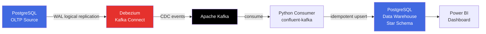
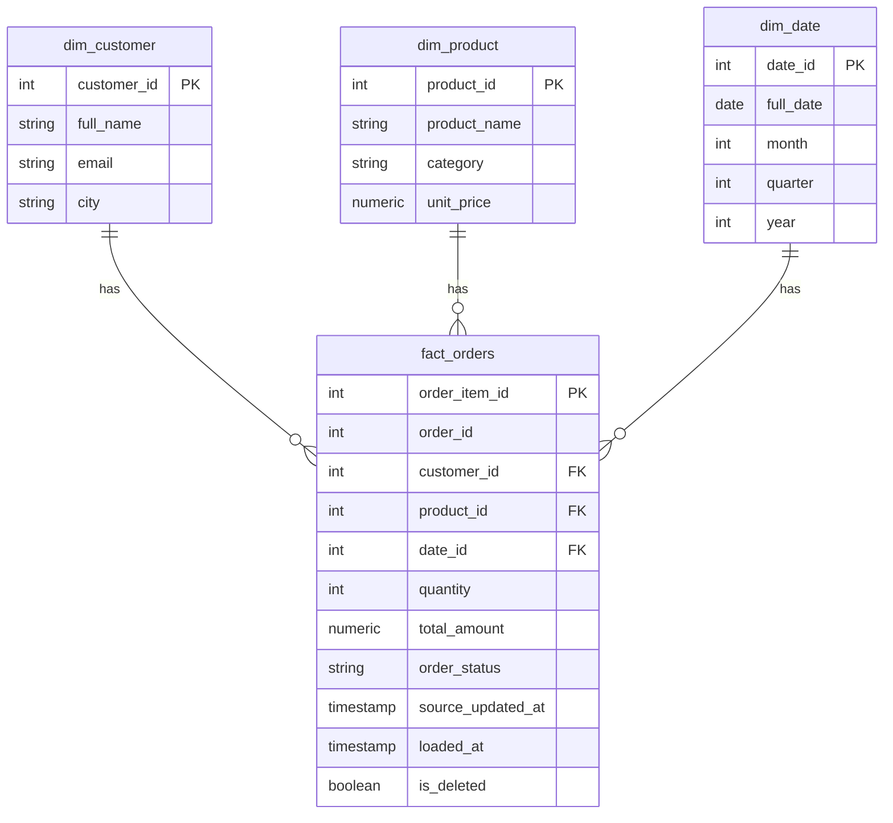
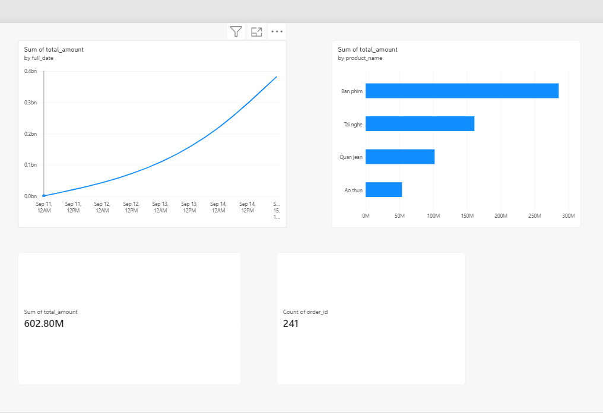

# CDC Pipeline: Debezium + Kafka + PostgreSQL

> Pipeline Change Data Capture (CDC) gần thời gian thực, bắt thay đổi dữ liệu từ hệ thống OLTP (PostgreSQL) qua Debezium và Kafka, nạp vào Data Warehouse theo mô hình Star Schema, phục vụ dashboard Business Intelligence (Power BI).

[](https://www.docker.com/)
[](https://debezium.io/)
[](https://kafka.apache.org/)
[](https://www.postgresql.org/)
[](https://www.python.org/)

---

## Mục lục

- [Giới thiệu](#giới-thiệu)
- [Kiến trúc hệ thống](#kiến-trúc-hệ-thống)
- [Công nghệ sử dụng](#công-nghệ-sử-dụng)
- [Cấu trúc thư mục](#cấu-trúc-thư-mục)
- [Hướng dẫn cài đặt và chạy](#hướng-dẫn-cài-đặt-và-chạy)
- [Kết quả thực nghiệm](#kết-quả-thực-nghiệm)
- [Dashboard BI](#dashboard-bi)
- [Hạn chế và hướng phát triển](#hạn-chế-và-hướng-phát-triển)
- [Tác giả](#tác-giả)

---

## Giới thiệu

Đồ án xây dựng một pipeline CDC (Change Data Capture) hoàn chỉnh, mô phỏng bài toán thực tế mà các doanh nghiệp có hệ thống giao dịch (OLTP) thường gặp: **đưa dữ liệu vận hành sang môi trường phân tích mà không làm chậm hệ thống chính, không mất dữ liệu, và có độ trễ đủ thấp để ra quyết định kịp thời.**

Pipeline bắt các thay đổi (INSERT / UPDATE / DELETE) từ một hệ thống bán hàng mô phỏng, truyền qua Kafka theo thời gian thực, và nạp vào một Data Warehouse dạng Star Schema để phục vụ báo cáo BI.

### Bài toán kỹ thuật trọng tâm

- Đo độ trễ (latency) end-to-end từ lúc dữ liệu thay đổi ở nguồn đến khi sẵn sàng phân tích ở đích
- Kiểm chứng tính đúng đắn dữ liệu khi có UPDATE và DELETE
- Đảm bảo khả năng phục hồi khi consumer bị dừng đột ngột rồi khởi động lại (không mất, không nhân đôi dữ liệu)

---

## Kiến trúc hệ thống



**Luồng xử lý:**

```
PostgreSQL (OLTP) → Debezium → Kafka → Python Consumer → Star Schema (DWH) → Power BI
```

### Mô hình dữ liệu (Star Schema)



---

## Công nghệ sử dụng

| Thành phần | Công nghệ |
|---|---|
| Cơ sở dữ liệu nguồn (OLTP) | PostgreSQL 15 |
| CDC | Debezium 2.7.3 (PostgreSQL connector, plugin `pgoutput`) |
| Message Broker | Apache Kafka 2.7.3 |
| Kafka Connect | Debezium Connect 2.7.3 |
| Consumer | Python 3.13, `confluent-kafka`, `psycopg2` |
| Data Warehouse | PostgreSQL 15 (Star Schema) |
| Trực quan hóa | Power BI Desktop |
| Hạ tầng | Docker & Docker Compose |

---

## Cấu trúc thư mục

```
cdc-pipeline/
├── docker-compose.yml          # Toàn bộ hạ tầng: Postgres x2, Kafka, Zookeeper, Kafka Connect
├── register-connector.json     # Cấu hình Debezium connector
├── init-scripts/
│   ├── source-init.sql         # Schema + seed data OLTP (customers, products, orders, order_items)
│   └── dwh-init.sql            # Star Schema (dim_customer, dim_product, dim_date, fact_orders, stg_orders)
├── consumer/
│   ├── consumer.py             # Consumer đọc Kafka, nạp Star Schema (idempotent upsert)
│   └── requirements.txt
├── testing/
│   ├── generator.py            # Sinh giao dịch liên tục để test tải/latency
│   ├── latency_report.py       # Đo latency end-to-end (avg, p50, p95, p99)
│   └── reconciliation.py       # Kiểm chứng tính đúng đắn dữ liệu (nguồn vs DWH)
└── README.md
```

---

## Hướng dẫn cài đặt và chạy

### Yêu cầu

- Docker Desktop
- Python 3.10+
- Power BI Desktop (tùy chọn, để xem dashboard)

### 1. Khởi động hạ tầng

```bash
docker compose up -d
docker compose ps
```

### 2. Đăng ký Debezium connector

```bash
curl -X POST -H "Content-Type: application/json" \
  --data "@register-connector.json" \
  http://localhost:8083/connectors
```

Kiểm tra trạng thái:
```bash
curl http://localhost:8083/connectors/oltp-postgres-connector/status
```

### 3. Cài thư viện và chạy consumer

```bash
cd consumer
pip install -r requirements.txt
python consumer.py
```

### 4. Sinh dữ liệu thử nghiệm

```bash
cd testing
python generator.py --count 50 --interval 0.5
```

### 5. Đo latency và kiểm chứng dữ liệu

```bash
python latency_report.py
python reconciliation.py
```

---

## Kết quả thực nghiệm

### Độ trễ end-to-end (đo trên 75 giao dịch)

| Chỉ số | Giá trị |
|---|---|
| Trung bình | 564.28 ms |
| Trung vị (p50) | 336.92 ms |
| P95 | 542.76 ms |
| P99 | 6,316.96 ms |

**95% giao dịch được phản ánh từ nguồn sang DWH trong dưới 0.55 giây.**

### Kiểm chứng tính đúng đắn dữ liệu

| Tiêu chí | Nguồn | DWH | Kết quả |
|---|---|---|---|
| Số dòng order_item | 468 | 468 | ✅ Khớp 100% |
| Tổng quantity | 1,354 | 1,354 | ✅ Khớp 100% |
| Tổng giá trị (VNĐ) | 602,800,000 | 602,800,000 | ✅ Khớp 100% |

### Kiểm thử phục hồi sau crash

Consumer bị dừng đột ngột giữa lúc hệ thống nguồn tiếp tục phát sinh 289 giao dịch mới. Sau khi khởi động lại (cùng consumer group), toàn bộ dữ liệu được xử lý đầy đủ, **không mất, không nhân đôi**, nhờ cơ chế idempotent upsert (`INSERT ... ON CONFLICT DO UPDATE`).

---

## Dashboard BI



Dashboard Power BI gồm:
- Biểu đồ doanh thu theo thời gian
- Biểu đồ top sản phẩm theo doanh thu
- KPI: tổng doanh thu, tổng số đơn hàng

---

## Hạn chế và hướng phát triển

- Dimension (`dim_customer`, `dim_product`) hiện chưa xử lý SCD Type 2 đầy đủ khi có DELETE ở nguồn
- Chưa xử lý schema evolution (khi bảng nguồn thay đổi cấu trúc)
- Chưa hỗ trợ multi-source CDC (nhiều database nguồn khác nhau)
- Hướng phát triển: tích hợp Lakehouse (Apache Iceberg/Delta Lake), bổ sung tầng data quality/observability tự động

