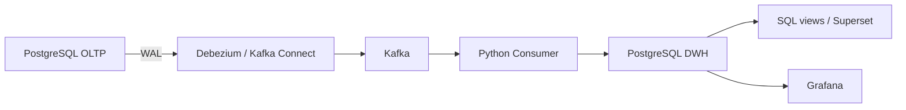
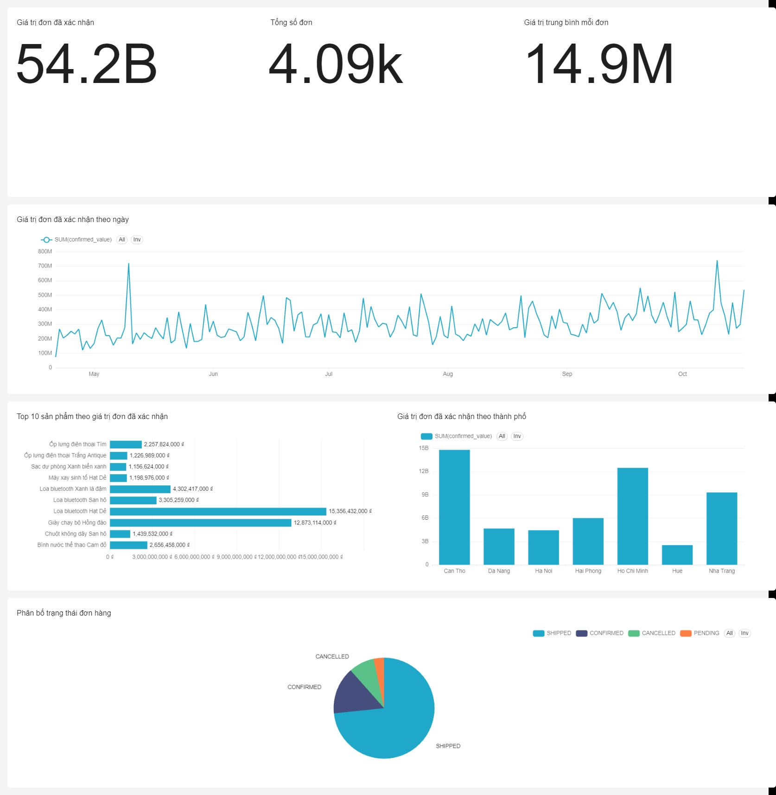

# CDC gần thời gian thực từ OLTP sang Phân tích

Pipeline bắt thay đổi `INSERT`, `UPDATE`, `DELETE` từ hệ thống bán hàng PostgreSQL, truyền qua Debezium và Kafka, rồi nạp vào Data Warehouse để phân tích bằng Apache Superset. Grafana được cấu hình để theo dõi độ trễ xử lý CDC, số event và hàng đợi chờ.

Dự án dùng dữ liệu mô phỏng và chạy local bằng Docker Compose. Báo cáo Power BI ban đầu được giữ lại để tham khảo.

## Kiến trúc



| Thành phần | Vai trò |
|---|---|
| PostgreSQL 15 | Database giao dịch và Data Warehouse riêng biệt |
| Debezium | Đọc thay đổi từ WAL bằng plugin `pgoutput` |
| Kafka, Zookeeper | Lưu và phân phối CDC event |
| Python, `confluent-kafka`, `psycopg2` | Xử lý event, upsert và ghi audit |
| Apache Superset | Dashboard bán hàng, sản phẩm và khách hàng |
| Grafana | Dashboard giám sát xử lý CDC |

Consumer lưu item chưa có đơn vào `pending_order_items`, commit transaction DWH trước khi commit Kafka offset. Upsert theo khóa giúp xử lý lại event; audit vẫn có thể ghi lặp. Đây là cơ chế **at-least-once**, chưa phải exactly-once toàn hệ thống.

## Mô hình dữ liệu và KPI

- **Nguồn:** `customers`, `products`, `orders`, `order_items`.
- **DWH:** `dim_customer`, `dim_product`, `dim_date`, `fact_orders`; kèm staging, audit và hàng đợi chờ.
- **Grain của fact:** một dòng cho một `order_item`. Đếm đơn bằng `COUNT(DISTINCT order_id)` hoặc dùng view `analytics.orders`.
- **Giá trị đơn đã xác nhận:** chỉ tính đơn `CONFIRMED` hoặc `SHIPPED`; chưa phải doanh thu thực thu vì chưa có dữ liệu thanh toán/hoàn tiền.
- **AOV:** giá trị trung bình mỗi đơn trong cùng tập lọc. Phân tích theo ngày đặt hàng, không theo thời điểm cập nhật CDC.

Các view phản ánh trạng thái hiện tại; cập nhật đơn cũ có thể thay đổi số liệu của ngày đặt hàng cũ. Dữ liệu mới xuất hiện trên màn hình khi dashboard chạy lại truy vấn hoặc tự làm mới.

## Cấu trúc dự án

```text
cdc-pipeline/
├── docker-compose.yml            # PostgreSQL x2, Kafka, Zookeeper, Connect
├── docker-compose.analytics.yml  # Superset và Grafana
├── register-connector.json       # Debezium PostgreSQL connector
├── init-scripts/                 # Schema nguồn và DWH
├── consumer/                     # Consumer và thư viện Python
├── testing/                      # Sinh dữ liệu, test, đo và đối soát
├── analytics/                    # SQL views, dashboard, cấu hình BI
├── reports/                      # Slide, phân công, lời thuyết trình
├── docs/                         # Ảnh báo cáo Power BI ban đầu
└── CDC_Dashboard.pbix             # Báo cáo Power BI ban đầu
```

## Chạy pipeline

Yêu cầu **Docker Desktop đang chạy**, Docker Compose và Python 3.10+. Các lệnh dưới đây dùng PowerShell, chạy từ thư mục gốc dự án.

### 1. Cài thư viện và bật hạ tầng

```powershell
python -m pip install -r consumer/requirements.txt
docker compose up -d
docker compose ps
```

Chờ PostgreSQL và Kafka Connect sẵn sàng. Database được khởi tạo từ `init-scripts/` khi volume được tạo lần đầu; chạy lại container không tự áp dụng các thay đổi SQL.

### 2. Áp dụng lớp phân tích

Chạy cho cả database mới và database đã tồn tại, trước khi chạy consumer:

```powershell
Get-Content -Raw analytics/migrate.sql | docker compose exec -T postgres-dwh psql -U postgres -d dwh_db -v ON_ERROR_STOP=1
Get-Content -Raw analytics/extended.sql | docker compose exec -T postgres-dwh psql -U postgres -d dwh_db -v ON_ERROR_STOP=1
```

### 3. Đăng ký Debezium

Chỉ đăng ký khi connector chưa tồn tại:

```powershell
curl.exe -X POST -H "Content-Type: application/json" --data-binary "@register-connector.json" http://localhost:8083/connectors
```

Kiểm tra connector và task đều ở trạng thái `RUNNING`:

```powershell
curl.exe http://localhost:8083/connectors/oltp-postgres-connector/status
```

### 4. Chạy consumer

```powershell
python consumer/consumer.py
```

Giữ terminal này mở. Consumer trên host kết nối Kafka ở `127.0.0.1:29092` và DWH ở `localhost:5433`.

### 5. Sinh dữ liệu ở terminal khác

Nếu muốn mở rộng dữ liệu nền, chạy một lần:

```powershell
python testing/seed_data.py --customers 100 --products 50
```

Để có lịch sử nhiều ngày, xem trước rồi thêm một lô:

```powershell
python testing/history_generator.py --days 180 --daily-orders 20
python testing/history_generator.py --days 180 --daily-orders 20 --apply
```

Mỗi lần `--apply` thêm một lô mới, kể cả khi seed giống nhau. Không chạy lại nếu đã nạp đủ lịch sử.

Để demo giao dịch đang phát sinh:

```powershell
python testing/generator.py --duration 300 --mean-interval 1 --skew 1.2
```

Generator tạo đơn mới, cập nhật trạng thái và xóa dòng hàng. Chờ consumer xử lý xong rồi làm mới dashboard. Tránh dùng `--wipe` hoặc xóa volume khi tiếp tục làm việc vì có thể làm mất dữ liệu nguồn và gây lệch với DWH.

## Dashboard

| Dashboard | Nội dung |
|---|---|
| Tổng quan bán hàng | Giá trị đã xác nhận, số đơn, AOV, xu hướng, trạng thái và thành phố |
| Phân tích sản phẩm | Top sản phẩm, danh mục, Pareto và sản phẩm mua cùng |
| Phân tích khách hàng | Khách mua lại, RFM, phân nhóm và cohort |
| CDC Pipeline (Grafana) | Latency p50/p95/p99, event/phút và pending items |

- **Superset:** <http://localhost:8088>. Cần khởi tạo tài khoản, kết nối database và dựng chart theo tài liệu; repo chưa có gói export để tự khôi phục dashboard Superset.
- **Grafana:** <http://localhost:3000>. Datasource và dashboard mẫu được provision khi khởi động service.

Ảnh minh họa tổng quan từ dữ liệu mô phỏng:



## Kiểm tra và đối soát

Unit test không yêu cầu Docker:

```powershell
python -m unittest discover -s testing -p 'test_*.py' -v
```

Khi nguồn và DWH đang chạy, dừng generator và chờ consumer bắt kịp trước khi đối soát:

```powershell
python testing/reconciliation.py
python testing/latency_report.py --minutes 15
```

`reconciliation.py` kiểm tra tổng hợp, giá trị từng dòng hàng và khóa dimension. `latency_report.py` dùng timestamp trong fact; dữ liệu snapshot cũ có thể làm nhiễu kết quả. View `analytics.cdc_minute` phục vụ Grafana dùng timestamp event Debezium, loại snapshot. Hai phép đo này khác nhau và đều chưa đo độ trễ đến màn hình BI.

Script `testing/repair_order_links.py` dành cho lỗi liên kết đơn khi ID dòng hàng được dùng lại. Mặc định chỉ xem trước; chỉ áp dụng sau khi xác nhận đúng lỗi. Script lưu bản trước sửa và không phải công cụ sửa mọi loại sai lệch.

## Giới hạn hiện tại

- Consumer một tiến trình; chưa benchmark lại hiệu năng sau các cải tiến.
- Chưa có dead-letter queue, schema evolution hoặc SCD Type 2 đầy đủ.
- Chưa tự xử lý việc reset/TRUNCATE nguồn và tái sử dụng ID; tránh reset nguồn độc lập với DWH.
- Chưa có lịch sử chuyển trạng thái đầy đủ, thanh toán, giá vốn và hoàn tiền.
- Phân nhóm khách hàng là quy tắc demo; chưa phải mô hình phân khúc được kiểm chứng.
- Giám sát chưa có cảnh báo tự động, Kafka lag và lịch sử đối soát định kỳ.

Cấu hình PostgreSQL dùng tài khoản demo `postgres/postgres`; Superset dùng SQLite metadata cho một instance. Thay tài khoản/kết nối và cấu hình vận hành trước khi triển khai dùng chung. Không commit `.env` hoặc thông tin truy cập thật.
